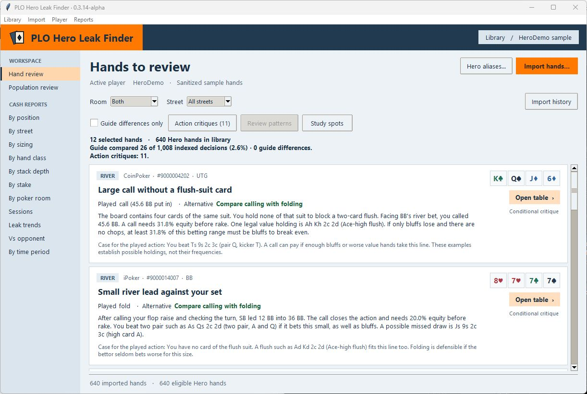

# PLO Hero Leak Finder

PLO Hero Leak Finder is a desktop app for offline PLO4 hand review on CoinPoker and iPoker, and your hands never leave your computer.

**0.3.22 beta** · [Download the Windows x64 ZIP](https://github.com/Texonja/plo-hero-leak-finder/releases/download/v0.3.22-beta/PLO-Hero-Leak-Finder-0.3.22-beta-Windows-x64.zip)



## What it finds

- **Decisions worth replaying.** The main list shows hands with a specific alternative, such as a missed multiway squeeze with aces or a costly flop call out of position. Open a hand to see the action and the reason.
- **Recurring spots.** Review patterns groups decisions with comparable spots and highlights differences from the guide. It shows the number of opportunities and whether differences recur across sessions.
- **Questions about ranges.** On supported postflop lines, open Study spots to explore categories of value hands and bluffs, or compare bet sizes under explicit assumptions.
- **Trends and comparisons.** Cash reports break down action frequencies and sample sizes by position, street, bet size, hand class, and session. Population review compares similar decisions in your local library. Luck and variance compares your deals and draw completions with their exact PLO4 card probabilities.

HeroDemo opens with five hands for review. In iPoker hand `9000020001`, four opponents called an open before Hero looked down at single-suited aces in the big blind. Hero called another 2.5 BB and six players saw the flop. The app suggests squeezing for value. The other examples cover a low small-blind limp-reraise, two costly flop calls and a button fold with queens.

## Coverage, honestly

On HeroDemo, the guide compares **26 of 1,029 indexed decisions (2.5%)** and presents prompts as study questions that leave any solver assessment to a separate analysis.

## Quality

The source suite has **331 tests** covering imports, chip accounting, replay, reports, and the standalone river pilot. Selected parsing and hand-strength results are cross-checked against the separate engines and source records listed in SOURCES.txt. The tests also check that incremental review updates agree with a fresh pass through the hands.

## Quick start

1. Download the Windows x64 ZIP from the [latest release](https://github.com/Texonja/plo-hero-leak-finder/releases/latest). Right-click the ZIP in File Explorer and choose **Extract all**.
2. Open the extracted folder and double-click **START.BAT**. The ZIP includes Python and Tk. The app runs offline and requires no installation.
3. Open **Library → HeroDemo** to try 644 sample hands from both networks. For your own completed hands, use **Import → Import files** or **Import → Import folder**. Set your screen names under **Player → Personal Hero aliases**, one per line under the correct network.

## Run from source

For development, use GitHub’s **Code → Download ZIP** or clone the repository. From the source folder, run the app with Python 3.11 or later and Tk installed.

```console
python launch.pyw
```

[User guide](docs/USER-GUIDE.md) · [Sources and sample provenance](SOURCES.txt) · [Standalone river solver pilot](https://github.com/Texonja/plo-hero-leak-finder/blob/main/pilots/river_solver/README.md)
